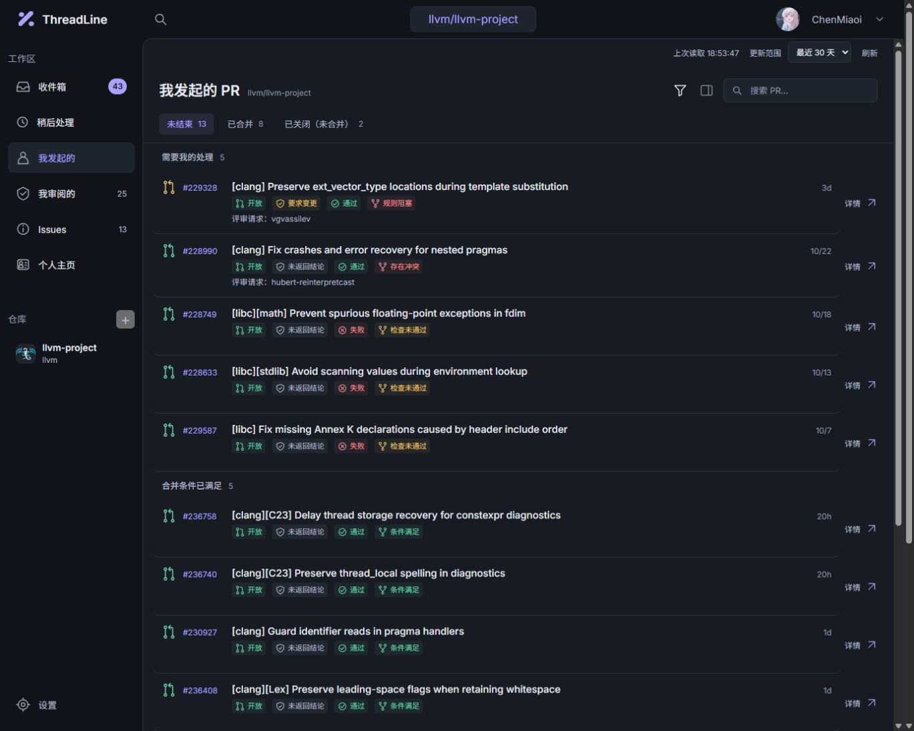
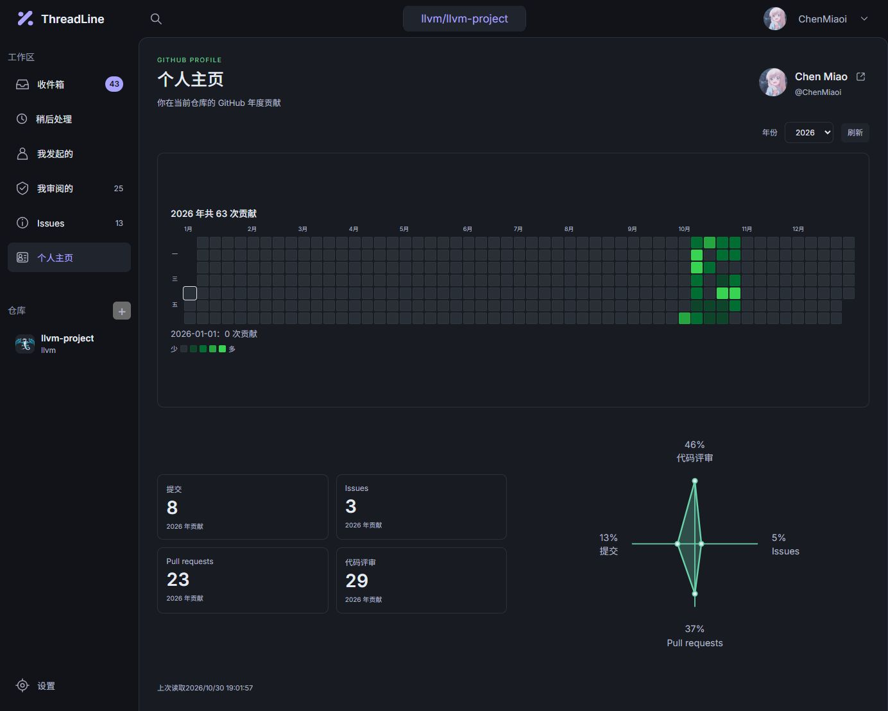

# ThreadLine

[](https://github.com/ChenMiaoi/threadline/actions/workflows/ci.yml)
[](LICENSE)
[](docs/development.md)
[](https://github.com/ChenMiaoi/threadline/releases/latest)

A local-first desktop workspace for GitHub collaboration.

ThreadLine brings the pull requests, reviews, and issues that need your attention into one repository-focused workspace. Read discussions, inspect changes, and keep track of what to return to without changing anything on GitHub.



_Current development UI, showing the public `llvm/llvm-project` repository in Simplified Chinese._

## Your repository, in one place

- **Inbox:** related PR and issue threads, with local unread markers and reminders.
- **Authored PRs:** lifecycle, review, check, and merge-condition summaries.
- **Review work:** requested reviews, participation, and new commits since your review.
- **Issues:** searchable discussions and labels for the selected repository.
- **PR details:** review summaries with their code-comment threads and replies, file changes, checks, syntax highlighting, and visual line wrapping.
- **Profile:** a responsive dashboard with your GitHub identity, repository-scoped annual contribution calendar, totals, and contribution breakdown.
- **Preferences:** separate interface, reading, and code typography controls using installed fonts, plus optional notification sounds and quiet hours.
- **Local storage:** disk-usage categories, targeted cache cleanup, and cache size limits.

Read markers, snoozes, and preferences stay on your device. Cached content remains available during temporary connection failures. Recoverable warnings appear in a floating panel that can collapse without moving the page.

<details>
<summary>Profile and contribution calendar</summary>



_Profile contributions for the public `llvm/llvm-project` repository, shown in the current Simplified Chinese interface._

</details>

## Read-only by design

ThreadLine signs in through its own GitHub App with read-only repository permissions. It does not post comments, submit reviews, merge PRs, or change GitHub notification subscriptions. Local read markers and snoozes do not mark GitHub notifications as read.

The Inbox is built from repository searches. It is **not GitHub's Notifications feed** or a complete event history. Profile contributions are scoped to the selected repository, rather than your account-wide GitHub contribution graph.

See [data and security](docs/data-and-security.md) for authorization, local storage, and cache behavior.

## Get ThreadLine

Download an installer from the [latest release](https://github.com/ChenMiaoi/threadline/releases/latest):

- **Windows x64:** the `.exe` installer.
- **macOS Apple Silicon:** the `aarch64.dmg` installer.
- **macOS Intel:** the `x64.dmg` installer.

See [getting started](docs/getting-started.md) for sign-in and installation details. CI debug installers are separate, temporary development artifacts.

### Build from source

Install the [development prerequisites](docs/development.md#prerequisites), then run:

```sh
git clone https://github.com/ChenMiaoi/threadline.git
cd threadline
npm ci
npm run desktop
```

### Connect GitHub

In the app:

1. Choose **Log in to GitHub** (**登录 GitHub**) and authorize ThreadLine Desktop using GitHub's device-code page.
2. Select a repository using its `owner/repository` name.
3. Open your authored PRs, review work, issues, or Inbox.

Public repositories do not require a GitHub App installation. Private repositories require the repository owner or organization to install the app and allow access to the repository. You do not need GitHub CLI, a personal access token, or your own app registration.

The interface supports English, Japanese, Simplified Chinese, and Traditional Chinese (Taiwan and Hong Kong). Choose a language in Settings; the screenshots above use Simplified Chinese.

## Documentation

Start at the [documentation index](docs/README.md), or go directly to:

- [Getting started](docs/getting-started.md) — installation options, sign-in, and repository selection.
- [Using the workspace](docs/workspace.md) — lists, previews, contribution calendars, and reminders.
- [Troubleshooting](docs/troubleshooting.md) — connection, access, cache, and display issues.
- [Development](docs/development.md) — prerequisites, commands, builds, and contribution checks.
- [Architecture](docs/architecture.md) — application boundaries and data flow.
- [GitHub App setup](docs/github-app-setup.md) — maintainer registration and permission configuration.

## Contribute

ThreadLine uses React and TypeScript for the interface, Rust and Tauri for desktop services, and SQLite for local persistence. Read the [development guide](docs/development.md) and [repository instructions](AGENTS.md) before making changes.

Run the complete verification suite before committing:

```sh
npm run check
```

See [testing](docs/testing.md) for focused checks and interface verification.

## License

[GNU General Public License v3.0 only](LICENSE) (`GPL-3.0-only`).

The bundled Inter and Noto Sans SC fonts retain their [Inter](public/licenses/inter-OFL.txt) and [Noto Sans SC](public/licenses/noto-sans-sc-OFL.txt) SIL Open Font License notices.
